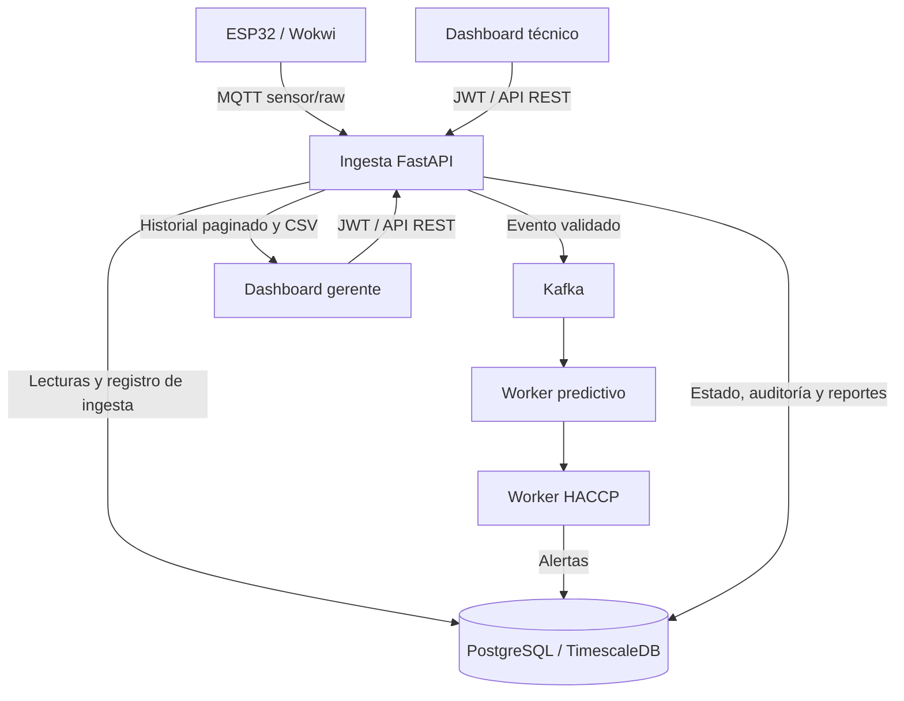
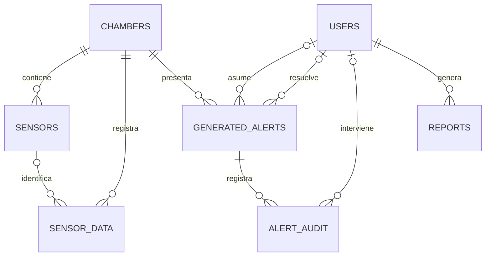
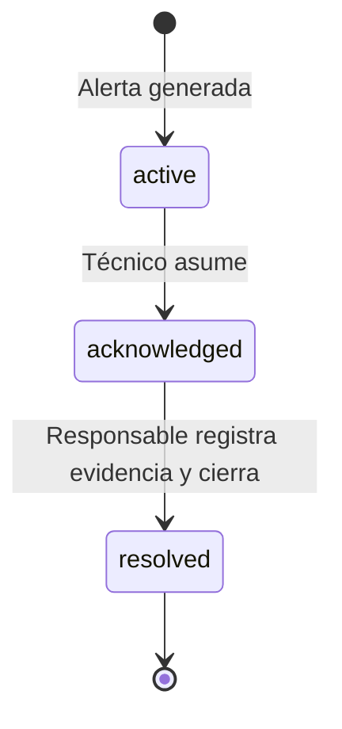

# CryoMetric — Informe técnico de integración de sensores y trazabilidad HACCP

| Identificación | Detalle |
|---|---|
| Proyecto | CryoMetric — Taller de Integración III |
| Repositorio | `Proyecto-Integracion-III` |
| Rama | `develop` |
| Fecha | 25 de noviembre de 2026 |
| Tarea de backlog | A5 — Alexis |
| Alcance | Ingesta, dashboard gerencial, dashboard técnico y telemetría IoT |
| Tipo de cambio | Nueva funcionalidad, integración y mejoras de seguridad y rendimiento |
| Estado | Implementación disponible; funcionamiento general confirmado por el integrante del equipo; validación integral documentada en secciones posteriores |

## 1. Resumen ejecutivo

Esta actualización integra la administración de sensores asociados a cámaras frigoríficas con el flujo de atención de alertas HACCP. El gerente puede gestionar dispositivos, consultar el historial de alertas bajo demanda y exportar intervenciones. El técnico puede identificar los sensores de la cámara afectada, asumir una alerta, consultar telemetría y registrar evidencia escrita de su resolución. La identidad del responsable y del usuario que cierra queda vinculada a la alerta y a la auditoría.

El desarrollo reutiliza las tablas y columnas existentes en PostgreSQL/TimescaleDB. Se conservan las mejoras anteriores de gestión de cámaras, monitoreo técnico, generación de UUID y consultas gerenciales acotadas. No se introduce un subsistema independiente de incidentes ni se requiere modificar el esquema de tablas. Los índices opcionales mejoran las rutas de consulta sin alterar los registros.

## 2. Contexto y objetivos

Antes de esta integración, el inventario de sensores estaba definido en la base de datos, pero su gestión y su vinculación con la intervención técnica no estaban integradas plenamente en el dashboard. El receptor MQTT no persistía el identificador del sensor al guardar las mediciones. Por otra parte, la atención de alertas necesitaba reforzar la responsabilidad individual, la evidencia de cierre y la consulta por parte de gerencia.

La tarea A5, de acuerdo con el requerimiento comunicado por el equipo, consiste en permitir que un técnico se haga cargo de una alerta y deje evidencia de cómo la cerró, de modo que el gerente pueda consultar el ID de la alerta y quién la resolvió en el historial y los reportes.

Los objetivos específicos son:

- Administrar sensores por cámara sin perder la telemetría histórica.
- Identificar el dispositivo que origina las nuevas mediciones cuando exista información suficiente.
- Registrar la asignación y resolución de alertas con identidad autenticada, fechas y evidencia.
- Prevenir asignaciones simultáneas y cierres no autorizados.
- Permitir consultas gerenciales bajo demanda y exportaciones acotadas, evitando descargar el historial completo.
- Mantener compatibilidad con el esquema de datos y los productores MQTT anteriores.

## 3. Arquitectura de la solución



El diagrama representa el flujo lógico de la arquitectura existente y la incorporación de A5; no implica que se hayan modificado los workers. La API de Ingesta centraliza la autorización y la persistencia. El dashboard React/Vite consume los endpoints mediante el cliente HTTP autenticado. Nginx actúa como proxy del frontend y Kubernetes administra los despliegues.

## 4. Modelo de datos reutilizado

| Tabla | Uso en la integración |
|---|---|
| `chambers` | Identificación de la cámara y pertenencia a la empresa. |
| `sensors` | Inventario del dispositivo, relación con la cámara, tipo, modelo, MQTT, MCU, firmware, calibración y estado. |
| `sensor_data` | Mediciones de temperatura y potencia, con `id_chamber` y `id_sensor` cuando se conoce. |
| `generated_alerts` | Estado, identificador, cámara, fechas y usuarios que asumen y resuelven. |
| `alert_audit` | Registro de acciones, usuario, fecha y detalle de intervención. |
| `users` y `roles` | Identificación y autorización del gerente y técnico. |
| `reports` | Registro de generación del reporte, empresa, usuario, rango y formato. |
| `ingestion_log` | Resultado de procesamiento de los mensajes y errores de recepción/persistencia/publicación. |



La alerta continúa asociada a la cámara, no directamente al sensor mediante una nueva clave foránea. El ID del sensor intervenido se conserva en `alert_audit.detail` junto con la intervención y la evidencia. Esta decisión evita alterar el esquema y evita atribuir automáticamente una alerta térmica a un dispositivo que puede estar funcionando correctamente. La contrapartida es que la relación de intervención con el sensor se conserva como texto, no como una FK consultable de forma relacional.

## 5. Funcionalidades implementadas

### 5.1. Gestión de cámaras y sensores (gerente)

Se preserva el CRUD de cámaras, la generación automática de UUID y las acciones de desactivación/reactivación. La creación se vincula a la empresa del usuario autenticado. Se agrega una vista de sensores por cámara, con registro y edición de sus características y estado (`active`, `inactive`, `maintenance`). El inventario se consulta por cursor con hasta 20 registros por petición. No se ofrece borrado físico de sensores para preservar las mediciones.

### 5.2. Diagnóstico de sensores (técnico)

El monitoreo permite consultar la última lectura identificada y hasta 20 lecturas recientes de las últimas 24 horas, junto con metadatos del dispositivo. La consulta se restringe a la cámara y sensor seleccionados. Se conserva el monitoreo térmico general de la cámara. No se inventan lecturas individuales a partir de valores históricos sin identificación. La ausencia de telemetría y el estado administrativo no constituyen por sí solos prueba de una falla física.

### 5.3. Atención y resolución de alertas (A5)



1. El técnico consulta las alertas pendientes y abre el detalle de la alerta.
2. Al asumirla, Ingesta obtiene `id_user` del JWT, registra `id_user_acknowledged` y `acknowledgment_date`, y crea una entrada de auditoría.
3. El técnico consulta los sensores de la cámara, revisa la telemetría y realiza la intervención necesaria.
4. El responsable selecciona el sensor intervenido si corresponde y registra una acción y una evidencia escrita de 15 a 500 caracteres.
5. Ingesta valida estado, identidad, empresa y pertenencia del sensor; guarda `id_user_resolved`, `resolution_date` y la evidencia en `alert_audit` dentro de la misma transacción.
6. El gerente consulta el historial y la auditoría de la alerta por su ID, y exporta el reporte de intervenciones.

El cierre no modifica automáticamente el estado administrativo de un sensor y no acredita por sí mismo que una temperatura volvió a su rango. El técnico debe comprobar las mediciones y registrar acciones reales. No se implementa reasignación de alertas; solo quien asumió una alerta puede resolverla.

### 5.4. Historial gerencial y reportes

La vista de alertas gerenciales mantiene un resumen de las alertas **generadas en las últimas 24 horas**, no un conteo global de todas las alertas abiertas. El historial se solicita explícitamente; permite filtrar por fecha de generación, cámara, estado, severidad, ID y técnico que cerró. Las consultas por período admiten hasta 31 días y devuelven hasta 20 alertas por página. La búsqueda directa por ID utiliza el endpoint de detalle y no requiere restringirse a un período. La auditoría se consulta bajo demanda (hasta las 100 acciones más recientes).

En Historial y Reportes se integra la consulta de intervenciones HACCP, preservando el acceso a predicciones y mediciones. El CSV exporta la selección filtrada completa hasta 1.000 alertas; si supera el límite se solicita reducir el alcance. Incluye ID de alerta y cámara, severidad, estado, descripción, fechas, IDs y nombres de responsable y cierre, evidencia de resolución y tiempos calculados. Se protege el texto libre frente a fórmulas de hojas de cálculo. Se registra la generación en `reports` (`haccp_interventions`, formato `csv`); no se conserva un archivo en el disco efímero del pod.

Los tiempos de respuesta y resolución se calculan respectivamente como `acknowledgment_date - generation_date` y `resolution_date - generation_date`, expresados en minutos. Los nombres se consultan desde `users` y pueden variar si se edita el perfil; los identificadores proporcionan la referencia de auditoría.

## 6. Contratos de API REST

Prefijo: `/api/v1`. Los endpoints de escritura requieren autenticación y autorización del servidor.

| Método | Ruta relativa | Rol | Función |
|---|---|---|---|
| GET | `/chambers/{id_chamber}/sensors` | Gerente/técnico | Inventario paginado. |
| POST | `/chambers/{id_chamber}/sensors` | Gerente | Registrar sensor. |
| PUT | `/chambers/{id_chamber}/sensors/{id_sensor}` | Gerente | Editar sensor o cambiar estado. |
| GET | `/chambers/{id_chamber}/sensors/{id_sensor}/diagnostics` | Gerente/técnico | Última lectura y lecturas recientes. |
| GET | `/alerts` | Gerente/técnico | Listar alertas con filtros, incluida opción `mine`. |
| GET | `/alerts/manager/summary` | Gerente | Resumen de 24 horas. |
| GET | `/alerts/manager/history` | Gerente | Historial por cursor. |
| GET | `/alerts/manager/technicians` | Gerente | Identidades de técnicos de la empresa (hasta 500). |
| GET | `/alerts/manager/report` | Gerente | Exportar CSV y registrar su generación. |
| GET | `/alerts/{id_alert}` | Gerente/técnico | Consultar alerta específica. |
| GET | `/alerts/{id_alert}/audit` | Gerente/técnico | Consultar auditoría. |
| PUT | `/alerts/{id_alert}/acknowledge` | Técnico | Asumir alerta activa. |
| PUT | `/alerts/{id_alert}/resolve` | Técnico responsable | Resolver con evidencia. |

Ejemplo de solicitud de cierre (ID y evidencia ilustrativos; adaptar a una intervención real):

```json
{
  "id_sensor": 1,
  "intervention": "Revisión del sensor",
  "note": "Se revisó el sensor y se verificaron nuevas mediciones dentro del rango permitido en la simulación."
}
```

El campo `id_sensor` puede ser nulo si no aplica. No se acepta un identificador de usuario enviado por el cliente como responsable del cierre.

## 7. Integración IoT y compatibilidad MQTT

Se añade `id_sensor` al modelo de entrada y al almacenamiento de telemetría. El tópico existente `sensor/raw` se conserva.

```json
{
  "id_chamber": "44444444-4444-4444-4444-444444444444",
  "id_sensor": 1,
  "temperature": -18.2,
  "consumption_kw": 1.5,
  "timestamp": "2026-11-25T06:00:00Z"
}
```

| Entrada | Comportamiento |
|---|---|
| ID explícito válido para la cámara | Persiste la lectura identificada y publica el evento validado a Kafka. |
| ID explícito inexistente o de otra cámara | Rechaza la lectura y registra el motivo. |
| Sin ID, exactamente un sensor registrado y activo | Asocia ese sensor. |
| Sin ID, cero sensores, varios sensores o único sensor no activo | Persiste a nivel de cámara sin asignar ID. |

La validación del ID explícito comprueba pertenencia, no exige estado activo. No se modifica la telemetría histórica. Si Kafka falla después de persistir, se registra el error; no se garantiza una entrega atómica entre PostgreSQL y Kafka.

El simulador debe añadir el ID real a `CameraConfig` y al JSON de `publishCamera`. Los IDs deben consultarse en PostgreSQL, no inferirse de los UUID ni del orden del arreglo. En la Cámara Principal 01 el sensor de temperatura es el 1 y el de humedad es el 2 según la consulta compartida por el equipo; el payload actual no envía humedad. Los sensores adicionales se registran previamente en el inventario. El sketch Wokwi y los cambios de datos manuales no aparecen entre los 18 archivos de la captura de GitHub Desktop.

## 8. Seguridad, consistencia y escalabilidad

| Control | Implementación |
|---|---|
| Identidad | JWT, autorización por rol y usuario de la sesión. |
| Aislamiento | Consultas de cámaras, sensores y alertas acotadas por empresa. |
| Concurrencia | `SELECT FOR UPDATE OF generated_alerts` al asumir y resolver; validación de estado dentro de la transacción. |
| Atomicidad | Actualización de alerta y auditoría en el mismo commit SQL. |
| Evidencia | Validación obligatoria de 15–500 caracteres; acción no vacía; sensor de la cámara. |
| Consultas gerenciales | Cursor por `(generation_date, id_alert)`, ventana máxima y límites explícitos. |
| Consultas SQL | `statement_timeout` de 5 s en rutas acotadas; `lock_timeout` de 3 s en transiciones de alertas PostgreSQL. |
| Exportación | Límite de 1.000 filas y neutralización de celdas que pudieran convertirse en fórmulas. |

Los límites anteriores son controles implementados, no resultados de una prueba de carga. La disponibilidad bajo carga y los planes reales de ejecución requieren medición con PostgreSQL/TimescaleDB y datos representativos.

## 9. Inventario de archivos del commit

La captura de GitHub Desktop muestra 18 archivos seleccionados en `develop`: 6 nuevos y 12 modificados. La descripción siguiente se basa en la captura y los archivos de la actualización entregada, no en un acceso directo al árbol local del integrante.

| Archivo | Estado | Responsabilidad |
|---|---|---|
| `microservices/dashboard/src/api/alertasGerente.js` | Nuevo | Cliente de resumen e historial gerencial. |
| `microservices/dashboard/src/api/intervenciones.js` | Nuevo | Atención, resolución, auditoría, técnicos y descarga CSV. |
| `microservices/dashboard/src/api/sensores.js` | Nuevo | Cliente de inventario y diagnóstico. |
| `microservices/dashboard/src/components/shared/AuditoriaAlerta.jsx` | Nuevo | Consulta y presentación de la auditoría. |
| `microservices/dashboard/src/components/shared/SensoresCamara.jsx` | Nuevo | Inventario, formulario y diagnóstico por cámara. |
| `microservices/dashboard/src/pages/gerente/Alertas.jsx` | Modificado | Resumen, filtros, cursor, responsables y evidencia bajo demanda. |
| `microservices/dashboard/src/pages/gerente/Camaras.jsx` | Modificado | Acceso a gestión de sensores, preservando CRUD de cámaras. |
| `microservices/dashboard/src/pages/gerente/Historial.jsx` | Modificado | Intervenciones HACCP y acceso al historial previo. |
| `microservices/dashboard/src/pages/tecnico/Alertas.jsx` | Modificado | Pendientes, mis alertas, resueltas y formulario de intervención. |
| `microservices/dashboard/src/pages/tecnico/Dashboard.jsx` | Modificado | Diagnóstico individual en monitoreo. |
| `microservices/ingesta/main.py` | Modificado | Registro del router de sensores. |
| `microservices/ingesta/models.py` | Modificado | Representación ORM de la tabla `reports` existente y ajustes relacionados. |
| `microservices/ingesta/mqtt_client.py` | Modificado | Asociación de telemetría y publicación validada. |
| `microservices/ingesta/routes/alerts.py` | Modificado | Transiciones, permisos, auditoría, historial y CSV. |
| `microservices/ingesta/routes/chambers.py` | Modificado | Restricción por empresa y reutilización del acceso a cámara. |
| `microservices/ingesta/routes/panel.py` | Modificado | Ajustes de consultas del panel y acceso por empresa. |
| `microservices/ingesta/routes/sensors.py` | Nuevo | Endpoints de inventario y diagnóstico. |
| `microservices/ingesta/schemas.py` | Modificado | Contratos de telemetría, alertas y auditoría. |

**Archivos complementarios:** la entrega A5 incluye `database/migrations/a5_indexes.sql`, `microservices/ingesta/tests/test_a5.py`, `tests/test_roles.py`, `tests/test_panel.py` (estos dos últimos relativos a Ingesta) y `LEEME-A5.md`. No aparecen en la captura como cambios pendientes; comprobar si ya están versionados, ignorados o todavía no se han incorporado. También se entregó anteriormente `database/migrations/manager_alerts_indexes.sql`. Se recomienda conservar las pruebas y scripts de índices en el repositorio.

## 10. Despliegue

Si los cambios ya están desplegados, no hace falta reconstruir los servicios solo para guardar este informe o realizar el commit. Para reproducir un despliegue de código, ejecutar desde la raíz:

```bash
docker build -t aamonsalve/cryometric-ingesta:latest ./microservices/ingesta
docker push aamonsalve/cryometric-ingesta:latest
kubectl rollout restart deployment/ingesta -n student-aamonsalve
kubectl rollout status deployment/ingesta -n student-aamonsalve

docker build -t aamonsalve/cryometric-dashboard:latest ./microservices/dashboard
docker push aamonsalve/cryometric-dashboard:latest
kubectl rollout restart deployment/dashboard -n student-aamonsalve
kubectl rollout status deployment/dashboard -n student-aamonsalve
kubectl get pods -n student-aamonsalve
```

No es necesario actualizar los workers ni crear tablas o columnas. Se recomienda verificar el estado de los índices previamente entregados. Si están pendientes, y los scripts existen en el árbol local, aplicar de forma independiente:

```bash
for migration in manager_alerts_indexes.sql a5_indexes.sql; do
  kubectl exec -i -n student-aamonsalve deployment/timescaledb -- \
    sh -c 'PGPASSWORD="$POSTGRES_PASSWORD" psql -U "$POSTGRES_USER" -d "$POSTGRES_DB" -v ON_ERROR_STOP=1' \
    < "database/migrations/$migration" || break
done
```

No envolver `CREATE INDEX CONCURRENTLY` en `BEGIN/COMMIT`. Los cuatro índices A5 cubren inventario por cámara, auditoría por alerta/acción/fecha, alertas por responsable/estado y alertas por usuario de cierre. Para transacciones manuales de modificación de datos sí se debe confirmar con `COMMIT` o cancelar con `ROLLBACK` para evitar bloqueos.

## 11. Validación y criterios de aceptación

### 11.1. Resultados disponibles

| Comprobación | Resultado documentado |
|---|---|
| Compilación Vite de la entrega | Exitosa. |
| Pruebas backend de la entrega | 16 pruebas y 72 subpruebas aprobadas, con SQLite y JWT; servicios externos simulados. |
| Advertencias de pruebas | 2 advertencias de deprecación de eventos de inicio FastAPI. |
| Funcionamiento general en el entorno del integrante | Confirmado por el integrante después de la actualización. |
| Bloqueos simultáneos reales, índices, rendimiento y pruebas detalladas en Kubernetes | Sin resultados de ejecución adjuntos a este informe. |

Estos resultados corresponden a la entrega desarrollada; no certifican cada archivo del árbol local ni una auditoría integral del clúster. No se declara una medición de rendimiento ni un porcentaje de cumplimiento no comprobado.

### 11.2. Matriz de aceptación y reproducción

| Caso | Acción | Resultado esperado |
|---|---|---|
| A5-01 | Técnico asume alerta activa | HTTP 200, `acknowledged`, responsable y fecha registrados. |
| A5-02 | Dos técnicos intentan asumir la misma alerta | Una operación exitosa; la otra recibe 409. Verificar en PostgreSQL. |
| A5-03 | Técnico responsable cierra con evidencia válida | HTTP 200, `resolved`, usuario y auditoría persistidos. |
| A5-04 | Cierre sin evidencia suficiente | HTTP 422, sin modificación de estado. |
| A5-05 | Otro técnico intenta cerrar | HTTP 403. |
| A5-06 | Sensor de otra cámara en el cierre | HTTP 422. |
| A5-07 | Gerente consulta ID y auditoría | Visualiza responsables, fechas y evidencia. |
| A5-08 | Gerente exporta CSV | Contiene la alerta, responsable, cierre y evidencia; registro en `reports`. |
| A5-09 | Acceso a alerta de otra empresa | HTTP 404 en detalle. |
| A5-10 | Técnico intenta exportar reporte gerencial | HTTP 403. |
| A5-11 | Historial con más de 31 días | HTTP 422. |
| A5-12 | Más de 20 alertas en intervalo | Cursor permite navegar sin repetir registros de la página anterior. |
| A5-13 | MQTT con ID correcto o incorrecto | Guarda asociación válida o registra rechazo. |
| A5-14 | Sensor sin ID en cámara con varios dispositivos | Guarda lectura a nivel de cámara sin atribución arbitraria. |

Ejecutar pruebas automatizadas si los archivos de pruebas y dependencias están instalados:

```bash
cd microservices/ingesta
python -m pytest -v tests/test_a5.py tests/test_roles.py tests/test_panel.py
cd ../dashboard
npm run build
```

### 11.3. Comprobaciones SQL de solo lectura

Entrar a la base de datos:

```bash
kubectl exec -it -n student-aamonsalve deployment/timescaledb -- \
  sh -c 'PGPASSWORD="$POSTGRES_PASSWORD" psql -U "$POSTGRES_USER" -d "$POSTGRES_DB"'
```

Sensores y lecturas recientes:

```sql
SELECT c.name, s.id_sensor, s.sensor_type, s.status, s.mqtt_identifier
FROM chambers c LEFT JOIN sensors s ON s.id_chamber = c.id_chamber
ORDER BY c.name, s.id_sensor;

SELECT id_chamber, id_sensor, temperature, consumption_kw, timestamp
FROM sensor_data
WHERE timestamp >= NOW() - INTERVAL '5 minutes'
ORDER BY timestamp DESC LIMIT 20;
```

Trazabilidad del cierre (en `psql`, sustituir 1058 por el ID real):

```sql
\set alerta_id 1058
SELECT a.id_alert, a.status, c.name AS camara,
       responsable.name AS tecnico_responsable,
       cierre.name AS tecnico_cierre,
       a.acknowledgment_date, a.resolution_date
FROM generated_alerts a
JOIN chambers c ON c.id_chamber = a.id_chamber
LEFT JOIN users responsable ON responsable.id_user = a.id_user_acknowledged
LEFT JOIN users cierre ON cierre.id_user = a.id_user_resolved
WHERE a.id_alert = :alerta_id;

SELECT aa.id_alert, u.name AS tecnico, aa.action, aa.detail, aa.action_date
FROM alert_audit aa LEFT JOIN users u ON u.id_user = aa.id_user
WHERE aa.id_alert = :alerta_id ORDER BY aa.action_date, aa.id_audit;

SELECT id_report, report_type, format, generation_date
FROM reports WHERE report_type = 'haccp_interventions'
ORDER BY generation_date DESC LIMIT 10;
```

## 12. Limitaciones y trabajo futuro

- La eliminación definitiva de cámaras mantiene el comportamiento de claves foráneas en cascada y puede eliminar alertas, mediciones y evidencia. Para preservar trazabilidad se recomienda desactivar cámaras con historial.
- La asociación del sensor intervenido se guarda en texto dentro de la auditoría; no existe una relación directa entre `generated_alerts` y `sensors`.
- El cierre exige evidencia escrita, no prueba automáticamente reparación física ni normalización térmica. No admite reasignación ni adjuntos de evidencia en esta entrega.
- La validación concurrente en TimescaleDB y las pruebas de carga con volúmenes representativos siguen siendo recomendables. El límite de la lista de técnicos y la consulta técnica por offset pueden requerir evolución con el crecimiento.
- El broker público y tópico compartido del simulador no son adecuados como mecanismo de identidad de dispositivos en producción; la pertenencia del ID a la cámara no equivale a autenticar al publicador MQTT. Se recomienda TLS, credenciales por dispositivo y ACL de tópicos.
- La deduplicación de alertas persistentes y la asignación organizacional de técnicos a cámaras no forman parte de esta actualización.

## 13. Conclusión

La integración permite ejecutar el flujo requerido en A5: asumir una alerta, intervenir la infraestructura, guardar evidencia y hacer visible la identidad del técnico en el historial y reportes. El inventario de sensores y el almacenamiento identificado de telemetría aportan contexto al diagnóstico, sin introducir nuevas tablas ni modificar los estados existentes de alertas. El enfoque gerencial bajo demanda y los controles de autorización y concurrencia reducen riesgos operacionales. La funcionalidad general fue confirmada por el integrante; la matriz anterior permite reproducir y registrar la validación detallada antes de declarar cerrado el requerimiento en el backlog.

## 14. Referencias internas de implementación

- Código: `microservices/ingesta/routes/alerts.py`, `routes/sensors.py`, `mqtt_client.py`, `models.py` y `schemas.py`.
- Interfaz: `microservices/dashboard/src/pages/` y `src/components/shared/`.
- Esquema base: `database/init.sql`; scripts opcionales: `database/migrations/`.
- Guía de entrega: `LEEME-A5.md` y pruebas `microservices/ingesta/tests/`.
- Requerimiento A5 comunicado por el equipo y captura de cambios de GitHub Desktop en `develop`.
