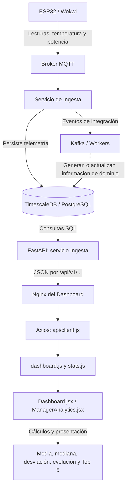

# Dashboard Cryometric — Sprint 3, A2: flujo de datos y validación con TimescaleDB en Kubernetes

> **Estado:** Documentación técnica de la implementación y procedimiento de verificación (pruebas de funcionamiento reportadas por el equipo; resultados SQL específicos pendientes de anexar).
> **Área SWEBOK:** KA5 — Software Testing (Pruebas de software).
> **Responsable:** Alexis — Dashboard.
> **Última actualización:** 2026-11-10.
> **Rama de referencia:** `feature/dashboard`.
> **Entorno objetivo:** Kubernetes, namespace `student-aamonsalve`.
> **Ubicación recomendada en el repositorio:** `docs/05-pruebas/dashboard.md` (archivo entregado de forma local; **no se ha modificado GitHub**).
> **Documentos relacionados:** [Plan de pruebas](../05-pruebas/plan-de-pruebas.md), [Arquitectura](../02-arquitectura/arquitectura.md), [Despliegue](../06-operaciones/despliegue.md).

---

## 1. Propósito

Explicar **de dónde salen los valores** del módulo **«Análisis estadístico de la planta»** del Dashboard del gerente y cómo comprobarlos, de forma independiente, desde **TimescaleDB ejecutándose en Kubernetes**.

La prueba busca demostrar tres aspectos:

1. Los datos se originan en las mediciones y alertas almacenadas en PostgreSQL/TimescaleDB; no son valores inventados en React.
2. FastAPI devuelve los registros o agregados correspondientes mediante endpoints existentes.
3. Las operaciones estadísticas y agrupaciones de React se pueden reproducir con consultas SQL sobre la base de datos.

> **Alcance:** Esta guía documenta principalmente **A2**. Se incluyen referencias a A1 para entender cómo se comparte la fuente de datos. No crea endpoints ni requiere cambios en el backend.

## 2. Resumen de la arquitectura y recorrido de la información



**Dos flujos que no deben confundirse:**

- **Telemetría:** Wokwi → MQTT → Ingesta → `sensor_data` → endpoint de consumo → gráfico y resumen de consumo.
- **Alertas:** worker/servicio que registra un incidente → `generated_alerts` → endpoint de alertas → evolución diaria y ranking de cámaras.

No basta con que Wokwi mande datos para que aparezcan alertas: tiene que existir un registro en `generated_alerts`. De la misma manera, que aparezca una temperatura fuera del umbral **no implica** que exista una alerta HACCP formal; el worker puede aplicar reglas y tiempos de tolerancia.

### ¿Por qué React no consulta TimescaleDB directamente?

El navegador no debe conectarse a PostgreSQL con credenciales. Se comunica mediante HTTP con **Nginx**, y este reenvía a **FastAPI**, donde se concentran el acceso a la base y las consultas de datos. React recibe JSON, lo presenta y calcula los estadísticos descriptivos de A2.

---

## 3. Componentes y archivos que participan

| Capa | Archivo / recurso | Responsabilidad |
|---|---|---|
| Simulación | `wokwi/` | Produce lecturas de sensores. |
| Base de datos | `sensor_data` | Mediciones con `id_chamber`, `timestamp`, `temperature` y `consumption_kw`. |
| Base de datos | `generated_alerts` | Alertas con `id_alert`, `id_chamber`, `generation_date`, `severity` y `status`. |
| Base de datos | `chambers` | Nombres de cámaras para el ranking. |
| FastAPI | `microservices/ingesta/routes/dashboard.py` | Implementa `/dashboard/live` y `/dashboard/consumption`. |
| FastAPI | `microservices/ingesta/routes/alerts.py` | Lista alertas por fecha descendente con límite/offset. |
| Nginx | `microservices/dashboard/nginx.conf` | Reenvía `/api/v1/` a `ingesta-service:8000`. |
| Cliente HTTP | `microservices/dashboard/src/api/client.js` | Axios con `baseURL` predeterminada `/api/v1` y token de sesión cuando existe. |
| Cliente A1 | `microservices/dashboard/src/api/dashboard.js` | `getDashboardLive()` y `getConsumptionSeries(7)`. |
| Cliente A2 | `microservices/dashboard/src/api/stats.js` | `getAlertasParaEstadisticas()`, máximo 200 registros. |
| Vista | `microservices/dashboard/src/pages/gerente/Dashboard.jsx` | Muestra KPI y consumo de A1; entrega `consumo` a A2. |
| Vista A2 | `microservices/dashboard/src/components/charts/ManagerAnalytics.jsx` | Sección desplegable, muestra estadísticas y gráficos. |
| Cálculos | `microservices/dashboard/src/utils/managerStats.js` | `resumirConsumoDiario()` y `prepararEstadisticasAlertas()`. |

> **Nota sobre los archivos A2:** Estos archivos fueron preparados localmente sobre A1. La rama remota podría no contener todavía todos los cambios de A2; la referencia principal para estas funcionalidades es la versión local que fue probada por el equipo.

### Endpoints reales usados

| Solicitud HTTP | Para qué sirve | Qué devuelve |
|---|---|---|
| `GET /api/v1/dashboard/live` | KPI de A1 | Cámaras habilitadas, alertas sin reconocer, potencia actual, ahorro potencial. |
| `GET /api/v1/dashboard/consumption?days=7` | Consumo A1 y estadísticos A2 | Lista de **7** objetos `{ "day": "AAAA-MM-DD", "kwh": número }`. |
| `GET /api/v1/alerts?limit=200&offset=0` | Gráficos de alertas de A2 | Hasta **200 alertas recientes** en orden descendente de `generation_date`. |

**No se llama a `/api/v1/stats/summary`:** era una dependencia indicada en el backlog, pero no estaba implementada en la rama revisada. A2 utiliza endpoints existentes; por ello debe describirse como **implementación funcional alternativa**, no como verificación del endpoint D5.

---

## 4. Cómo se calculan los datos de consumo

### 4.1. Diferencia entre potencia y energía

- **`consumption_kw` (kW):** potencia instantánea registrada por una cámara.
- **`kwh` (kWh):** energía aproximada consumida durante un intervalo.

La relación es:

```math
E\;(\mathrm{kWh}) = P\;(\mathrm{kW}) \times \Delta t\;(\mathrm{horas})
```

En `dashboard.py`, FastAPI ordena las mediciones **por cámara**, identifica la siguiente lectura con `LEAD(timestamp)` y estima la energía correspondiente al intervalo entre ambas. Para evitar que los cortes de datos inflen el consumo, acota el intervalo a **300 segundos (5 minutos)**:

```math
E_i = P_i \times \frac{\min(t_{i+1}-t_i,\ 300\ \mathrm{s})}{3600}
```

Después suma las energías de **todas las cámaras** agrupadas por día en la zona horaria `America/Santiago`. Devuelve **dos decimales** por día y completa con `0` los días sin registros computables.

**Consecuencias que debes conocer:**

- Un día con `0 kWh` **no prueba** que hubo consumo cero: también puede significar que faltaron lecturas.
- La última lectura de una cámara no tiene una lectura siguiente dentro del conjunto consultado, por lo que no aporta un intervalo en esta estimación.
- La energía estimada depende de la frecuencia y continuidad de los datos de Wokwi.
- Las estadísticas de A2 describen los **7 valores diarios devueltos por la API**, incluidos los ceros.

### 4.2. Cálculos estadísticos en React

`Dashboard.jsx` llama `getConsumptionSeries(7)` y conserva un arreglo con datos diarios `{day, kwh}`. Ese arreglo se transmite como propiedad:

```jsx
<ManagerAnalytics consumo={consumo} />
```

En `managerStats.js`, la función `resumirConsumoDiario(consumo)` calcula:

**Media diaria** (promedio):

```math
\bar{x} = \frac{\sum_{i=1}^{n}x_i}{n}
```

**Mediana:** se ordenan los consumos. Si hay siete días, se toma el **cuarto** valor. Para cantidad par, se promedian los dos centrales.

**Desviación estándar poblacional:**

```math
\sigma = \sqrt{\frac{\sum_{i=1}^{n}(x_i-\bar{x})^2}{n}}
```

Se divide por `n`, **no por `n - 1`**. React redondea visualmente a **un decimal**. PostgreSQL puede reproducir los cálculos con `AVG`, `PERCENTILE_CONT(0.5)` y `STDDEV_POP`.

**Valores de una captura de referencia:** media `2,8 kWh`, mediana `0,1 kWh` y desviación `5,1 kWh`. Esos son los valores observados en pantalla, **no los resultados de una ejecución SQL guardada en esta documentación**. Si entra más telemetría, pueden cambiar.

---

## 5. Cómo se calculan los gráficos de alertas

Al **abrir** la sección «Análisis estadístico de la planta», `ManagerAnalytics.jsx` llama a `getAlertasParaEstadisticas()` en `stats.js`, que consulta:

```http
GET /api/v1/alerts?limit=200&offset=0
```

La respuesta se filtra **en el navegador** por `generation_date`, usando el periodo seleccionado de **7, 14 o 30 días**, desde la medianoche del primer día hasta el momento actual (hora local del navegador).

### 5.1. Evolución diaria

`prepararEstadisticasAlertas()` cuenta **cuántos registros de alertas fueron generados cada día**. Se incluyen los estados `active`, `acknowledged` y `resolved`, porque importa la **fecha de generación** y no el estado actual.

### 5.2. Top 5 cámaras con más alertas

La misma función agrupa las alertas del periodo por `id_chamber` (o por nombre cuando no hay ID), cuenta registros y ordena de mayor a menor. Finalmente muestra **cinco cámaras como máximo**.

### 5.3. Limitaciones explícitas

- **Tope de 200 registros:** si la API devuelve exactamente 200, no es posible asegurar que la muestra abarque todo el periodo. La interfaz debe mostrar la advertencia de muestra limitada.
- **No son 200 lecturas:** son hasta 200 **registros de alertas**.
- **No son alertas activas:** incluye reconocidas y resueltas; **no debe compararse directamente** con el KPI `active_alerts` de A1, que cuenta solamente estado `active`.
- **Cero alertas dentro de los últimos 7 días** no significa que jamás haya habido alertas; puede haber registros anteriores al rango.
- El rango se calcula con la **zona horaria del navegador**. Las consultas SQL de esta guía utilizan explícitamente `America/Santiago`; si el navegador está configurado en otra zona, pueden aparecer diferencias en los límites de día.

### 5.4. Control de consultas y rendimiento

- A1 solicita el resumen aproximadamente cada **15 segundos** y consumo cada **60 segundos**, planificando el siguiente intento tras completar el anterior.
- A2 **no solicita alertas mientras su sección está cerrada**.
- Abrir el análisis dispara la consulta de alertas.
- Cambiar de 7 a 14 o 30 días **reutiliza** los registros descargados (no vuelve a consultar).
- El botón **Actualizar** solicita de nuevo las alertas.
- A2 calcula agregados localmente y renderiza **dos gráficos**, no una tabla con 200 filas.

Esto reduce el trabajo del navegador y la frecuencia de llamadas, pero **no constituye actualización reactiva por eventos** (SSE/WebSocket). Sigue siendo una implementación de consultas HTTP controladas.

---

## 6. Verificar TimescaleDB en Kubernetes (solo lectura)

### 6.1. Confirmar entorno y disponibilidad

Ejecutar desde una terminal Ubuntu con `kubectl` ya configurado:

```bash
kubectl config current-context
kubectl get deployment timescaledb -n student-aamonsalve
kubectl get pods -n student-aamonsalve -l app=timescaledb
kubectl get service timescaledb-service -n student-aamonsalve
```

La definición revisada declara un Deployment llamado `timescaledb`, servicio `timescaledb-service` en puerto `5432`, y base `frigorifico`. **El manifiesto no demuestra por sí solo que la instalación actual use exactamente esa configuración**: los comandos anteriores lo comprueban.

### 6.2. Abrir `psql` dentro del Deployment

```bash
kubectl exec -it -n student-aamonsalve deployment/timescaledb -- \
  sh -c 'PGPASSWORD="$POSTGRES_PASSWORD" psql -U "$POSTGRES_USER" -d "$POSTGRES_DB" -v ON_ERROR_STOP=1'
```

Esto utiliza las variables de entorno del contenedor y evita escribir la contraseña en el historial de la terminal.

**Comandos iniciales dentro de `psql`:**

```sql
SELECT current_database(), current_user, now();
\dt
SELECT COUNT(*) AS lecturas FROM sensor_data;
SELECT COUNT(*) AS alertas FROM generated_alerts;
```

**Para salir:** `\q`.

---

## 7. SQL de verificación: consumo y estadísticos de A2

### 7.1. Últimas lecturas de Wokwi almacenadas

```sql
SELECT id_chamber, timestamp, temperature, consumption_kw
FROM sensor_data
ORDER BY timestamp DESC
LIMIT 10;
```

**Interpretación:** confirma que se persisten las mediciones; estas filas son **potencia en kW**, no totales diarios en kWh.

```sql
SELECT
  COUNT(*) AS total_lecturas,
  COUNT(DISTINCT id_chamber) AS camaras_con_lecturas,
  MAX(timestamp) AS ultima_lectura
FROM sensor_data;
```

### 7.2. Reproducir los 7 días de consumo de FastAPI y los tres estadísticos

> Esta consulta reproduce la lógica usada en `dashboard.py`: búsqueda desde hace `days+1` días, energía `kW × horas`, máximo 300 segundos entre lecturas, agrupación en Chile y **redondeo a 2 decimales por día antes de obtener estadísticos**, tal como hace React a partir del JSON.

```sql
WITH lecturas AS (
    SELECT
        id_chamber,
        timestamp,
        consumption_kw,
        LEAD(timestamp) OVER (
            PARTITION BY id_chamber ORDER BY timestamp
        ) AS siguiente_lectura
    FROM sensor_data
    WHERE timestamp >= NOW() - INTERVAL '8 days'
      AND consumption_kw IS NOT NULL
),
consumo_diario AS (
    SELECT
        (timestamp AT TIME ZONE 'America/Santiago')::date AS dia,
        SUM(
            consumption_kw *
            LEAST(EXTRACT(EPOCH FROM (siguiente_lectura - timestamp)), 300)
            / 3600.0
        ) AS kwh
    FROM lecturas
    WHERE siguiente_lectura IS NOT NULL
    GROUP BY 1
),
ultimos_7_dias AS (
    SELECT
        (NOW() AT TIME ZONE 'America/Santiago')::date - g.i AS dia,
        ROUND(COALESCE(d.kwh, 0)::numeric, 2) AS kwh
    FROM generate_series(0, 6) AS g(i)
    LEFT JOIN consumo_diario d
      ON d.dia = (NOW() AT TIME ZONE 'America/Santiago')::date - g.i
),
resumen AS (
    SELECT
        ROUND(AVG(kwh), 1) AS media_kwh,
        ROUND(
            (PERCENTILE_CONT(0.5) WITHIN GROUP (ORDER BY kwh))::numeric,
            1
        ) AS mediana_kwh,
        ROUND(STDDEV_POP(kwh), 1) AS desviacion_kwh
    FROM ultimos_7_dias
)
SELECT
    u.dia, u.kwh,
    r.media_kwh, r.mediana_kwh, r.desviacion_kwh
FROM ultimos_7_dias u
CROSS JOIN resumen r
ORDER BY u.dia;
```

**Qué cotejar:**

1. La columna `kwh` debe coincidir con los siete valores de `GET /dashboard/consumption?days=7` si las consultas se ejecutan aproximadamente al mismo tiempo.
2. `media_kwh`, `mediana_kwh` y `desviacion_kwh` deben coincidir con A2 **a un decimal**.
3. Si difieren, verificar nuevos datos de Wokwi, zona horaria, días con cero y redondeo.

---

## 8. SQL de verificación: alertas y gráficos de A2

### 8.1. Inspeccionar el histórico completo

```sql
SELECT
    COUNT(*) AS total_historico,
    MIN(generation_date) AS primera_alerta,
    MAX(generation_date) AS ultima_alerta
FROM generated_alerts;

SELECT id_alert, id_chamber, generation_date, severity, status
FROM generated_alerts
ORDER BY generation_date DESC
LIMIT 10;
```

### 8.2. Reproducir la muestra de hasta 200 y el filtro de 7 días

La fecha de inicio es la **medianoche de hace seis días** en Chile; el rango incluye hoy, al igual que el análisis de 7 días del navegador local.

```sql
WITH muestra AS (
    SELECT id_alert, id_chamber, generation_date
    FROM generated_alerts
    ORDER BY generation_date DESC
    LIMIT 200
),
limite AS (
    SELECT
      (((NOW() AT TIME ZONE 'America/Santiago')::date - 6)::timestamp
        AT TIME ZONE 'America/Santiago') AS inicio
)
SELECT
    COUNT(*) AS muestra_consultada,
    COUNT(*) FILTER (
        WHERE generation_date >= limite.inicio
          AND generation_date <= NOW()
    ) AS dentro_de_7_dias,
    MIN(generation_date) AS mas_antigua_en_muestra,
    MAX(generation_date) AS mas_reciente_en_muestra
FROM muestra
CROSS JOIN limite;
```

**Qué cotejar:**

- `muestra_consultada` ↔ “Se consultaron N registros recientes”.
- `dentro_de_7_dias` ↔ “N corresponden al periodo seleccionado”.
- Si `muestra_consultada = 200`, el análisis debe quedar señalado como **potencialmente parcial**.

### 8.3. Evolución diaria (hasta 200 alertas recientes)

```sql
WITH muestra AS (
    SELECT generation_date
    FROM generated_alerts
    ORDER BY generation_date DESC
    LIMIT 200
),
limite AS (
    SELECT
      (((NOW() AT TIME ZONE 'America/Santiago')::date - 6)::timestamp
        AT TIME ZONE 'America/Santiago') AS inicio
)
SELECT
    (m.generation_date AT TIME ZONE 'America/Santiago')::date AS dia,
    COUNT(*) AS cantidad
FROM muestra m
CROSS JOIN limite l
WHERE m.generation_date >= l.inicio
  AND m.generation_date <= NOW()
GROUP BY 1
ORDER BY 1;
```

Los días sin alertas no aparecen como filas aquí. **React completa esos días con cero** para formar la evolución diaria de siete días.

### 8.4. Top 5 cámaras con más alertas de la muestra

```sql
WITH muestra AS (
    SELECT id_chamber, generation_date
    FROM generated_alerts
    ORDER BY generation_date DESC
    LIMIT 200
),
limite AS (
    SELECT
      (((NOW() AT TIME ZONE 'America/Santiago')::date - 6)::timestamp
        AT TIME ZONE 'America/Santiago') AS inicio
)
SELECT
    COALESCE(c.name, m.id_chamber::text, 'Cámara sin identificar') AS camara,
    COUNT(*) AS cantidad
FROM muestra m
CROSS JOIN limite l
LEFT JOIN chambers c ON c.id_chamber = m.id_chamber
WHERE m.generation_date >= l.inicio
  AND m.generation_date <= NOW()
GROUP BY m.id_chamber, c.name
ORDER BY cantidad DESC, camara
LIMIT 5;
```

**Nota:** la consulta agrupa por `id_chamber` como React. Si la API entrega nombres distintos o faltantes, la etiqueta visual puede variar, pero la cantidad por identificador debería coincidir.

---

## 9. Comparación adicional: FastAPI vs. TimescaleDB en el clúster

Para comprobar que **la misma base** alimenta al Dashboard, abre en una terminal:

```bash
kubectl port-forward -n student-aamonsalve svc/dashboard-service 8502:80
```

Luego, desde otra terminal:

```bash
curl -sS 'http://localhost:8502/api/v1/dashboard/consumption?days=7' | python3 -m json.tool
curl -sS 'http://localhost:8502/api/v1/alerts?limit=200&offset=0' | python3 -m json.tool
```

**Precaución:** si `/alerts` requiere JWT, `curl` sin sesión puede devolver `401`; el Dashboard obtiene el token de la sesión mediante Axios. No publiques tokens en capturas ni documentos.

Para comparar correctamente:

1. Ejecuta la consulta SQL del apartado 7.2 y el `curl` de consumo en un intervalo corto.
2. Contrasta las **siete fechas** y sus **siete kWh**.
3. Contrasta los **tres estadísticos** que muestra React.
4. Ejecuta los SQL de alertas y compara los conteos con el panel abierto.
5. Toma capturas o guarda la salida de los comandos como evidencia de la prueba.

---

## 10. Interpretar correctamente un panel sin alertas

**Caso observado en una captura de A2:**

- Se consultaron **200 registros recientes**.
- El filtro de **7 días** encontró **0 registros de alertas**.
- Los gráficos de evolución diaria y Top 5 estaban vacíos.

Esto es **coherente** si las 200 alertas más recientes tienen fechas anteriores al periodo seleccionado. Para demostrarlo, basta consultar `MAX(generation_date)` y compararlo con el inicio de los siete días.

No es suficiente concluir “HACCP funciona” o “HACCP falla” solo a partir de esa pantalla: el panel refleja **los registros que la API devolvió** y su fecha de generación.

---

## 11. Evidencias y criterios de aceptación de A2

| Prueba | Evidencia esperada | Resultado |
|---|---|---|
| Conectividad Kubernetes ↔ TimescaleDB | `psql` abre base `frigorifico` | ☐ Adjuntar salida |
| Telemetría Wokwi persistida | Filas recientes en `sensor_data` | ☐ Adjuntar salida |
| API de consumo | Siete pares `day`/`kwh` | ☐ Adjuntar JSON |
| Media, mediana y desviación | SQL y tarjeta de React coinciden a 1 decimal | ☐ Adjuntar comparación |
| API de alertas | Hasta 200 registros, ordenados por fecha | ☐ Adjuntar JSON/consulta |
| Evolución diaria | Conteo SQL corresponde al periodo | ☐ Adjuntar comparación |
| Ranking Top 5 | Orden y cantidades corresponden a SQL | ☐ Adjuntar comparación |
| Advertencia de muestra incompleta | Aparece al recibir 200 alertas | ☐ Captura |
| Sin valores simulados | No hay fallback de estadísticas en A2 | ☐ Comprobación |

**Registro sugerido de ejecución:**

```text
Fecha/hora de la prueba (Chile): __________________
Contexto Kubernetes: ______________________________
Namespace: student-aamonsalve
Pod de TimescaleDB: _______________________________
Total de lecturas: ________________________________
Última lectura: ___________________________________
Consumo total de siete días (kWh): _________________
Media (kWh): ______________________________________
Mediana (kWh): ____________________________________
Desviación estándar poblacional (kWh): _____________
Alertas consultadas (máximo 200): _________________
Alertas en el periodo: ____________________________
Observaciones y capturas: _________________________
```

---

## 12. Problemas frecuentes y cómo interpretarlos

| Síntoma | Explicación probable | Comprobación |
|---|---|---|
| `kubectl exec` no encuentra el Deployment | Nombre/namespace/contexto distinto | `kubectl get deployments -n student-aamonsalve` |
| `psql` no conecta | Pod no disponible, variables de entorno distintas o BD no lista | `kubectl get pods -l app=timescaledb -n student-aamonsalve` |
| SQL y React difieren ligeramente | Wokwi siguió enviando datos o hubo redondeos | Comparar consultas en el mismo momento y con 2 decimales por día |
| React muestra `0 kWh` | Puede no haber suficientes lecturas para calcular intervalos | Consultar `COUNT(*)`, `MIN/MAX(timestamp)` |
| Media > mediana | Días con consumos altos o distribución sesgada | Ver los siete valores ordenados |
| Hay 200 alertas pero los gráficos están vacíos | Alertas anteriores al rango, o muestra truncada | Consultar fechas `MIN/MAX(generation_date)` |
| HTTP 401 en `curl` | Endpoint protegido sin token | Verificar autenticación sin publicar credenciales |
| Top 5 no coincide con total histórico SQL | A2 usa solo 200 alertas recientes y un rango temporal | Aplicar en SQL el mismo `LIMIT 200` y el mismo filtro |
| Cambiar a 14/30 días no consulta de nuevo | Ese selector filtra una muestra ya descargada | Pulsar **Actualizar** si se requieren datos nuevos |

---

## 13. Explicación breve para la presentación al profesor

> El módulo A2 obtiene datos reales desde TimescaleDB, desplegado en Kubernetes. Wokwi genera mediciones que Ingesta almacena en `sensor_data`. FastAPI consulta esas mediciones y estima la energía diaria a partir de potencia por tiempo, acotando a cinco minutos cada intervalo entre lecturas. La API entrega los siete consumos diarios y React calcula media, mediana y desviación estándar poblacional. Comprobamos esos valores reproduciendo el mismo cálculo directamente en PostgreSQL.
>
> Para las alertas usamos `generated_alerts`: FastAPI devuelve hasta 200 registros recientes y React los agrupa por día y por cámara. Mostramos una advertencia cuando la muestra llega al máximo, para no presentar un resultado incompleto como total oficial. El análisis está cerrado por defecto y solo carga alertas cuando el gerente lo solicita, evitando consultas y representaciones innecesarias.

**Conclusión:** La validez de A2 se demuestra comparando **fuente de datos → cálculo SQL → JSON de FastAPI → estadísticos React**, no solo observando gráficos en pantalla. Esta guía conserva la trazabilidad técnica de esa comprobación.

---

## 14. Referencias de código (consulta / solo lectura)

- Backend de consumo y KPI: [`microservices/ingesta/routes/dashboard.py`](https://github.com/JoseCalfiman/Proyecto-Integracion-III/blob/feature/dashboard/microservices/ingesta/routes/dashboard.py).
- Backend de alertas: [`microservices/ingesta/routes/alerts.py`](https://github.com/JoseCalfiman/Proyecto-Integracion-III/blob/feature/dashboard/microservices/ingesta/routes/alerts.py).
- Esquema de BD: [`database/init.sql`](https://github.com/JoseCalfiman/Proyecto-Integracion-III/blob/feature/dashboard/database/init.sql).
- Configuración Nginx del Dashboard: [`microservices/dashboard/nginx.conf`](https://github.com/JoseCalfiman/Proyecto-Integracion-III/blob/feature/dashboard/microservices/dashboard/nginx.conf).
- Manifiesto TimescaleDB: [`k8s/timescaledb/deployment.yaml`](https://github.com/JoseCalfiman/Proyecto-Integracion-III/blob/feature/dashboard/k8s/timescaledb/deployment.yaml).
- Documentación general del proyecto: [`docs/README.md`](https://github.com/JoseCalfiman/Proyecto-Integracion-III/blob/feature/dashboard/docs/README.md).
- A2 local: `src/components/charts/ManagerAnalytics.jsx`, `src/utils/managerStats.js`, `src/api/stats.js` (del paquete A2 probado por el equipo; no necesariamente publicados en remoto).
