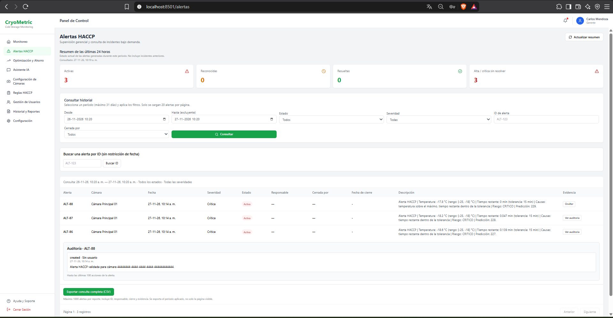
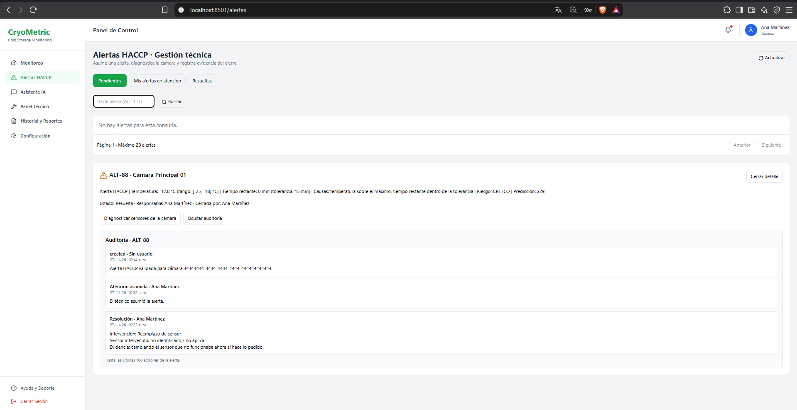

# E7 — Prueba de incidente Predictivo → HACCP → Técnico (Sprint 3)

| Campo | Valor |
|---|---|
| Tarea | E7 — Probar incidente Predictivo → HACCP → Técnico |
| Hito | Flujo completo documentado con `prediction_id` y `alert_id` |
| Prueba | Logs + API + Dashboard + consultas BD |
| Dependencias | M3, D3, A5 |
| Fecha de ejecución | 2026-11-27, ~10:14 hora Chile (13:14 UTC) |

---

## 1. Objetivo

Verificar de extremo a extremo que una desviación de temperatura en una cámara de frío recorre todo el sistema y termina atendida y cerrada por un técnico, con trazabilidad completa desde la lectura hasta la resolución:

```
ESP32 simulado
  → Mosquitto (tópico sensor/raw)
  → Ingesta (persiste lectura)
  → Kafka sensor.raw
  → Worker Predictivo  ──→ tabla predictions
                       └─→ Kafka sensor.anomaly
  → Worker HACCP       ──→ tablas generated_alerts + alert_audit
                       └─→ Kafka haccp.alerts
  → Dashboard técnico
  → acknowledge (atención asumida)
  → resolve (resolución con intervención y evidencia)
```

## 2. Entorno

| Elemento | Detalle |
|---|---|
| Infraestructura | Docker Compose local |
| Rama | `develop` |
| Broker MQTT | Mosquitto, tópico `sensor/raw`, usuario `esp32` |
| Mensajería | Kafka: `sensor.raw`, `sensor.anomaly`, `haccp.alerts` |
| Base de datos | TimescaleDB / PostgreSQL 16 (tablas `sensor_data`, `predictions`, `generated_alerts`, `alert_audit`) |
| Origen de datos | Publicación MQTT manual simulando un ESP32 (sin Wokwi) |

## 3. Escenario controlado

**Cámara:** `44444444-4444-4444-4444-444444444444` (Cámara Principal 01).

**Regla HACCP aplicada (id 1):**

| Parámetro | Valor |
|---|---|
| Temperatura mínima | -25 °C |
| Temperatura máxima | -18 °C |
| Tolerancia | 15 min |
| Severidad | critical |
| Estado | activa |

**Lecturas publicadas** en `sensor/raw` como usuario `esp32`, una cada 5 s, simulando un ascenso de temperatura que cruza el máximo:

| # | Timestamp (UTC) | Temperatura |
|---|---|---|
| 1 | 2026-11-27T13:14:08.027Z | -19.0 °C |
| 2 | 2026-11-27T13:14:13.598Z | -18.6 °C |
| 3 | 2026-11-27T13:14:19.277Z | -18.2 °C |
| 4 | 2026-11-27T13:14:24.652Z | -17.8 °C |

## 4. Identificadores trazados

| Lectura | Offset Kafka `sensor.raw` | Resultado Predictivo | `id_prediction` | `id_alert` |
|---|---|---|---|---|
| 1 (-19.0 °C) | 213 | `VENTANA_INSUFICIENTE`, `SIN_RIESGO`, no publica | — | — |
| 2 (-18.6 °C) | 214 | Pendiente 4.31 °C/min, tiempo restante 0.14 min, `CRITICO` | 227 | 86 |
| 3 (-18.2 °C) | 215 | Tiempo restante 0.05 min, `CRITICO` | 228 | 87 |
| 4 (-17.8 °C) | 216 | Tiempo restante 0.00 min (sobre el máximo), `CRITICO`, condición `DATOS_VARIABLES` | **229** | **88** |

**Caso principal documentado:** `id_prediction = 229` → `id_alert = 88`.

## 5. Evidencia

### 5.1 Logs

**Ingesta:** cada una de las 4 lecturas se guardó en base de datos y se envió a Kafka `sensor.raw` (offsets 213, 214, 215 y 216).

**Worker Predictivo:**

- Lectura 1: `VENTANA_INSUFICIENTE` → `SIN_RIESGO`; no publica en `sensor.anomaly`.
- Lectura 2: pendiente 4.31 °C/min, tiempo restante 0.14 min → `CRITICO` → predicción 227 publicada.
- Lectura 3: tiempo restante 0.05 min → `CRITICO` → predicción 228 publicada.
- Lectura 4: tiempo restante 0.00 min (sobre el máximo), condición `DATOS_VARIABLES` → `CRITICO` → predicción 229 publicada.

**Worker HACCP:**

```
Alerta HACCP guardada para cámara 44444444-4444-4444-4444-444444444444
Alerta 86 publicada en haccp.alerts
Alerta HACCP guardada para cámara 44444444-4444-4444-4444-444444444444
Alerta 87 publicada en haccp.alerts
Alerta HACCP guardada para cámara 44444444-4444-4444-4444-444444444444
Alerta 88 publicada en haccp.alerts
```

**Latencia observada:** entre la predicción 227 (13:14:13.966) y la alerta 86 (13:14:14.568) transcurrieron ~0,6 s.

### 5.2 Base de datos

**`predictions` ↔ `generated_alerts`:**

| `id_prediction` | `id_alert` | `id_haccp_rule` | `severity` | `status` (al crearse) |
|---|---|---|---|---|
| 227 | 86 | 1 | critical | active |
| 228 | 87 | 1 | critical | active |
| 229 | 88 | 1 | critical | active |

**Mensaje de la alerta 88:**

> Alerta HACCP \| Temperatura: -17.8 °C (rango: [-25, -18] °C) \| Tiempo restante: 0 min (tolerancia: 15 min) \| Causas: temperatura sobre el máximo, tiempo restante dentro de la tolerancia \| Riesgo: CRITICO \| Predicción: 229.

**Estado final de la alerta 88:**

| Campo | Valor |
|---|---|
| `status` | resolved |
| Responsable (reconocimiento) | Ana Martínez (tecnico@cryometric.cl) |
| Cerrada por (resolución) | Ana Martínez (tecnico@cryometric.cl) |

**`alert_audit` de la alerta 88 (ordenado por `action_date`):**

| # | Acción | Usuario | Fecha (hora Chile) | Detalle |
|---|---|---|---|---|
| 1 | `created` | — (worker HACCP) | 27-11-26 ~10:14 (al generarse la alerta) | Alerta HACCP validada para cámara 44444444-4444-4444-4444-444444444444. |
| 2 | `acknowledged` (Atención asumida) | Ana Martínez | 27-11-26 10:22 | El técnico asumió la alerta. |
| 3 | `resolved` (Resolución) | Ana Martínez | 27-11-26 10:22 | Intervención: Reemplazo de sensor / Sensor intervenido: no identificado / no aplica / Evidencia: cambiando el sensor que no funcionaba ahora si hace lo pedido |

Ciclo de auditoría completo: **created → acknowledged → resolved**.

### 5.3 API

**`GET /api/v1/alerts/88`**

{
    "id_alert":  88,
    "id_chamber":  "44444444-4444-4444-4444-444444444444",
    "chamber_name":  "Cámara Principal 01",
    "id_prediction":  229,
    "id_haccp_rule":  1,
    "alert_type":  "haccp_violation",
    "severity":  "critical",
    "status":  "resolved",
    "message":  "Alerta HACCP | Temperatura: -17.8 °C (rango: [-25, -18] °C) | Tiempo restante: 0 min (tolerancia: 15 min) | Causas: temperatura sobre el máximo, tiempo restante dentro de la tolerancia | Riesgo: CRITICO | Predicción: 229.",
    "generation_date":  "2026-11-27T13:14:24.901506Z",
    "id_user_acknowledged":  "33333333-3333-3333-3333-333333333333",
    "acknowledgment_date":  "2026-11-27T13:22:13.667934Z",
    "id_user_resolved":  "33333333-3333-3333-3333-333333333333",
    "resolution_date":  "2026-11-27T13:22:51.232207Z",
    "acknowledged_by":  "Ana MartÃnez",
    "resolved_by":  "Ana MartÃnez"
}

**`GET /api/v1/alerts/88/audit`**

{
    "value":  [
                  {
                      "id_audit":  85,
                      "id_alert":  88,
                      "id_user":  null,
                      "action":  "created",
                      "detail":  "Alerta HACCP validada para cámara 44444444-4444-4444-4444-444444444444.",
                      "action_date":  "2026-11-27T13:14:24.894762Z",
                      "user_name":  null
                  },
                  {
                      "id_audit":  86,
                      "id_alert":  88,
                      "id_user":  "33333333-3333-3333-3333-333333333333",
                      "action":  "acknowledged",
                      "detail":  "El técnico asumió la alerta.",
                      "action_date":  "2026-11-27T13:22:13.667934Z",
                      "user_name":  "Ana MartÃnez"
                  },
                  {
                      "id_audit":  87,
                      "id_alert":  88,
                      "id_user":  "33333333-3333-3333-3333-333333333333",
                      "action":  "resolved",
                      "detail":  "Intervención: Reemplazo de sensor\nSensor intervenido: no identificado / no aplica\nEvidencia: cambiando el sensor que no funcionaba ahora si hace lo pedido",
                      "action_date":  "2026-11-27T13:22:51.232207Z",
                      "user_name":  "Ana MartÃnez"
                  }
              ],
    "Count":  3
}
### 5.4 Dashboard

**Vista del gerente — alertas activas antes de la atención técnica.** Se observan las alertas 86, 87 y 88 en estado Activa y severidad Crítica.




**Dashboard técnico — alerta 88 resuelta con su auditoría.**




## 6. Resultado

| Verificación | Esperado | Obtenido |
|---|---|---|
| Lecturas MQTT recibidas por Ingesta | 4 lecturas guardadas | 4 lecturas guardadas ✅ |
| Publicación en Kafka `sensor.raw` | 4 mensajes | Offsets 213–216 ✅ |
| Predictivo con ventana insuficiente | No publica anomalía | Lectura 1: `VENTANA_INSUFICIENTE`, `SIN_RIESGO`, sin publicación ✅ |
| Predictivo detecta riesgo | Predicciones `CRITICO` persistidas | 227, 228, 229 ✅ |
| Worker HACCP genera alerta por predicción | Una alerta por `id_prediction` | 227→86, 228→87, 229→88 ✅ |
| Alerta asociada a la regla correcta | `id_haccp_rule = 1`, `critical`, `active` | Las tres alertas ✅ |
| Publicación en Kafka `haccp.alerts` | Alertas publicadas | "Alerta 86/87/88 publicada en haccp.alerts" ✅ |
| Latencia predicción → alerta | Del orden de segundos | ~0,6 s (227 → 86) ✅ |
| Mensaje con causa | Temperatura, rango, tiempo, causas, riesgo y predicción | Mensaje completo en alerta 88 ✅ |
| Auditoría inicial | `created` sin usuario | `created`, sin usuario, creada por el worker ✅ |
| Visualización en dashboard gerente | Alertas activas y críticas | 86, 87 y 88 Activas/Críticas ✅ |
| Acknowledge por técnico | `acknowledged`, usuario técnico | Ana Martínez, 27-11-26 10:22 ✅ |
| Resolve con intervención y evidencia | `resolved`, detalle con intervención y evidencia | Reemplazo de sensor + evidencia, 27-11-26 10:22 ✅ |
| Ciclo de auditoría completo | created → acknowledged → resolved | created → acknowledged → resolved ✅ |

**Resultado global: APROBADO.** El incidente `id_prediction 229` → `id_alert 88` quedó trazado de extremo a extremo.

### Observaciones

- Cada lectura con riesgo genera su propia predicción y su propia alerta (227→86, 228→87, 229→88); el worker HACCP no duplica alertas para una misma predicción (E2).
- El mensaje de la alerta incluye la causa (E1) y la auditoría registra el ciclo completo (E4); el cierre exige intervención y evidencia (A5).
- Para la prueba local fue necesario:
  - aplicar `database/migrations/002_prediction_diagnostics.sql` en una base existente;
  - configurar `JWT_SECRET` en `.env`;
  - alinear las credenciales MQTT de `.env` con `mosquitto/pwfile`.

## 7. Consultas SQL utilizadas

**Relación `predictions` ↔ `generated_alerts` por `id_prediction`:**

```sql
SELECT p.id_prediction,
       p.id_chamber,
       p.calculated_slope,
       p.projected_temperature,
       p.remaining_time_min,
       p.risk_level,
       p.calculation_date,
       a.id_alert,
       a.id_haccp_rule,
       a.severity,
       a.status,
       a.generation_date,
       a.generation_date - p.calculation_date AS latencia
FROM predictions p
JOIN generated_alerts a ON a.id_prediction = p.id_prediction
WHERE a.id_alert = 88;
```

**Estado de la alerta con usuarios de reconocimiento y resolución:**

```sql
SELECT a.id_alert,
       a.id_prediction,
       a.status,
       a.severity,
       a.message,
       a.generation_date,
       ua.name  AS reconocida_por,
       ua.email AS email_reconocimiento,
       a.acknowledgment_date,
       ur.name  AS resuelta_por,
       ur.email AS email_resolucion,
       a.resolution_date
FROM generated_alerts a
LEFT JOIN users ua ON ua.id_user = a.id_user_acknowledged
LEFT JOIN users ur ON ur.id_user = a.id_user_resolved
WHERE a.id_alert = 88;
```

**Auditoría de la alerta ordenada por `action_date`:**

```sql
SELECT au.id_audit,
       au.action,
       u.name AS usuario,
       au.detail,
       au.action_date
FROM alert_audit au
LEFT JOIN users u ON u.id_user = au.id_user
WHERE au.id_alert = 88
ORDER BY au.action_date, au.id_audit;
```
